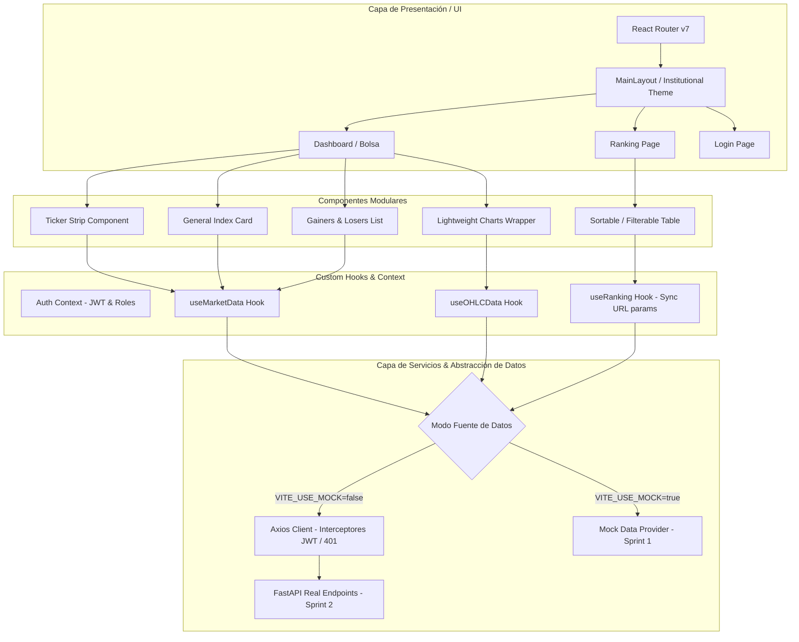

# SIFTC - Documento de Arquitectura, Especificaciones y Contexto Base (Frontend)

> **Sistema de Información Financiera de Trazabilidad y Competitividad (SIFTC)**  
> **Asignatura:** Sistemas de Información · Momento 2 · Octubre 2026  
> **Rol Asignado al Usuario:** Oscar Andrés Hundelshaussen Barreto (Estructura base, rutas, login, mock data Sprint 1 e integración API real Sprint 2).

---

## 1. Resumen Ejecutivo del Proyecto

### 1.1 ¿Qué es el SIFTC?
El **SIFTC** es una plataforma que centraliza, audita, estandariza y publica métricas financieras de diversas entidades u organizaciones, presentándolas bajo una **metáfora de bolsa de valores**.
- Cada entidad registrada "cotiza" en el mercado según un **Índice de Competitividad (IC)** calculado de 0 a 100.
- El sistema resuelve la dispersión de datos en hojas de cálculo no estandarizadas, la falta de trazabilidad en el origen del dato y la ausencia de métricas homogéneas para comparar la competitividad entre organizaciones.
- El flujo global es:
  $$\text{Matriz CSV} \longrightarrow \text{Backend Python (FastAPI)} \longrightarrow \text{Capas (Bronze/Silver/Gold)} \longrightarrow \text{Motor de Cálculo (IC, OHLC, Ranking)} \longrightarrow \text{Frontend Web (React) + Móvil (Flutter)}$$

---

## 2. Alcance Específico del Equipo Frontend (Momento 2)

El corte tiene una duración de **2 semanas (2 Sprints de 1 semana)** y comprende **4 Historias de Usuario (26 puntos)**:

| Sprint | Código | Historia de Usuario | Pts | Responsable Principal |
| :--- | :--- | :--- | :---: | :--- |
| **Sprint 1** | **HU-FE-09** | **Colores institucionales y diseño responsive**: Paleta institucional, tipografía, variables CSS, accesibilidad (contraste y símbolos $\blacktriangle$/$\blacktriangledown$), responsive (360px, 768px, 1280px) y entrega de sistema de diseño a Móvil. | 5 | Rafael Barriga y Sara Alarcano |
| **Sprint 1** | *Tarea de Apoyo* | **Estructura base del proyecto y datos simulados**: Setup de React + Vite, router, layout, autenticación base y mocks de API. | - | **Oscar Hundelshaussen** |
| **Sprint 1** | *Tarea de Apoyo* | **Revisión responsive inicial**: Asegurar adaptabilidad a 360px, 768px y 1280px sin desbordamiento horizontal. | - | Reinel Alfaro |
| **Sprint 2** | **HU-FE-01** | **Tablero tipo bolsa (Dashboard)**: Ticker de cotizaciones, tarjeta de índice general, Top 5 ganadores y Top 5 perdedores. Carga inicial < 3 segundos. | 8 | Rafael Barriga |
| **Sprint 2** | **HU-FE-02** | **Gráficas financieras interactivas**: Gráficas de velas japonesas (Candlestick) y líneas mediante librería financiera (`Lightweight Charts`), selectores de periodo (1D, 1S, 1M, 1A, Máx), tooltips con valores OHLC y zoom. | 8 | Sara Alarcano |
| **Sprint 2** | **HU-FE-04** | **Ranking interactivo con filtros**: Tabla de clasificación ordenada por IC, filtros por sector, dimensión y periodo, ordenación por columnas y sincronización de filtros con los Query Params de la URL. | 5 | Reinel Alfaro |
| **Sprint 2** | *Tarea de Apoyo* | **Integración de API real**: Sustituir datos de ejemplo por la API REST de FastAPI, manejo de tokens JWT, control de errores `401 Unauthorized`. | - | **Oscar Hundelshaussen** |

### Elementos fuera del alcance para este corte (Backlog futuro / Sprint 3+):
- **HU-FE-03**: Ficha de entidad detallada en web (pasa a Sprint 3).
- **HU-FE-05**: Comparador de hasta 4 entidades lado a lado.
- **HU-FE-06**: Visor de linaje navegable de datos.
- **HU-FE-07**: Módulo de administración CRUD completo de usuarios y catálogos.
- **HU-FE-08**: Bandeja de aprobación de publicaciones para analistas.
- Modo oscuro completo, Ticker WebSocket en tiempo real, MFA/SSO y exportación a PDF/Excel.

---

## 3. Diccionario de Términos Bursátiles y Financieros

Para comprender la lógica de negocio y las interfaces sin confusiones:

1. **Ticker (Cinta de cotizaciones)**:
   - *En trading tradicional:* Es la marquesina o cinta en movimiento que muestra en tiempo real las transacciones de las empresas (código abreviado, precio actual y variación porcentual).
   - *En SIFTC:* Es la barra superior animada o tablero de resumen que muestra las entidades, su valor de IC actual y si subieron o bajaron ($\blacktriangle +2.3\%$ en verde o $\blacktriangledown -1.4\%$ en rojo).

2. **IC (Índice de Competitividad)**:
   - Equivale al **"precio de la acción"** de la entidad. Es un valor normalizado entre **0 y 100**, calculado como el promedio ponderado de 10 métricas clave.

3. **OHLC (Open, High, Low, Close)**:
   - Representa los 4 precios fundamentales de un activo en un intervalo de tiempo:
     - **Open (Apertura)**: Valor del IC al iniciar el periodo.
     - **High (Máximo)**: Valor más alto alcanzado por el IC en ese lapso.
     - **Low (Mínimo)**: Valor más bajo tocado en ese lapso.
     - **Close (Cierre)**: Último valor registrado al cierre del periodo.

4. **Gráfica de Velas Japonesas (Candlestick Chart)**:
   - Tipo de gráfico financiero estándar. Cada "vela" dibuja el rango OHLC:
     - El **cuerpo** de la vela representa el espacio entre la Apertura y el Cierre (verde si subió, rojo si bajó).
     - Las **sombras/mechas** (líneas verticales superior e inferior) marcan los máximos y mínimos alcanzados.

5. **Top Ganadores (Gainers) y Top Perdedores (Losers)**:
   - Clasificación de las 5 entidades que tuvieron la mayor variación porcentual positiva vs. las 5 con la mayor caída en su índice en el corte actual.

6. **Dimensiones Financieras**:
   - Grupos ponderados que componen el IC:
     - **Rentabilidad (35%)**: ROE, ROA, Margen EBITDA.
     - **Liquidez (20%)**: Razón corriente, Prueba ácida.
     - **Solvencia (20%)**: Nivel de endeudamiento, Cobertura de intereses.
     - **Crecimiento y Mercado (25%)**: Crecimiento de ingresos, Variación de cotización.

7. **Linaje del Dato (Data Lineage)**:
   - La cadena de procedencia y trazabilidad que permite auditar un número: qué archivo CSV lo alimentó, quién lo procesó, qué fórmula se aplicó y cuándo se publicó.

8. **Watchlist**:
   - Lista personalizada de entidades favoritas que un usuario marca para seguimiento rápido (destacado en la app móvil).

---

## 4. Arquitectura de Software Recomendada para el Frontend

Para asegurar alta mantenibilidad, cumplimiento del requerimiento de carga **< 3s**, facilidad de testeo y aislamiento entre mocks y API real:



### Estructura de Carpetas Propuesta en `src/`:

```text
src/
├── assets/                  # Logos institucionales, iconos SVG
├── components/              # Componentes reutilizables
│   ├── common/              # Botones, Cards, Badges, Modales, Loaders
│   ├── charts/              # Wrapper de TradingView Lightweight Charts
│   │   ├── FinancialChart.jsx
│   │   └── PeriodSelector.jsx
│   ├── layout/              # Navbar, Sidebar, Footer, Layout principal
│   ├── ranking/             # RankingTable, RankingFilters
│   └── ticker/              # TickerTape, TickerCard
├── context/                 # AuthContext (Sesión, User, Roles, Logout)
├── hooks/                   # useAuth, useMarket, useRankingUrlParams, useChart
├── pages/                   # Vistas principales enrutadas
│   ├── DashboardPage.jsx    # Tablero tipo bolsa (HU-FE-01)
│   ├── RankingPage.jsx      # Tabla de ranking con filtros (HU-FE-04)
│   ├── ChartDemoPage.jsx    # Vista de gráficas y análisis (HU-FE-02)
│   ├── LoginPage.jsx        # Acceso con usuario y credenciales
│   └── NotFoundPage.jsx
├── services/                # Conexión HTTP y Mocking
│   ├── api.js               # Instancia de Axios con interceptores de Token y 401
│   ├── authService.js       # Endpoints de login/logout
│   ├── marketService.js     # Obtención de IC, Ticker, Top 5
│   ├── rankingService.js    # Obtención de tabla de posiciones filtrada
│   └── mockData/            # Datos JSON estáticos para Sprint 1
│       ├── marketMocks.js
│       ├── ohlcMocks.js
│       └── rankingMocks.js
├── styles/                  # Variables CSS institucionales y estilos globales
│   ├── variables.css        # Colores de la universidad, tokens de subida/bajada
│   └── index.css
├── App.jsx                  # Definición de rutas
└── main.jsx                 # Entrypoint
```

---

## 5. Especificación de Pantallas y Funcionalidades

### 5.1 Pantalla de Login (`/login`)
- **Propósito:** Autenticación para usuarios institucionales.
- **Campos:** Usuario / Correo institucional, Contraseña.
- **Comportamiento:** Guarda el token JWT en `localStorage`/`sessionStorage` y redirige al Tablero Principal.
- **Seguridad:** En caso de expiración o token inválido, interceptor redirige a `/login` limpiando la sesión.

### 5.2 Tablero Principal tipo Bolsa (`/` o `/dashboard`) - HU-FE-01
- **Ticker Horizontal:** En la parte superior, muestra el listado de activos deslizante o en cuadrícula compacta con nombre/código, IC actual y variación ($\blacktriangle$ verde / $\blacktriangledown$ roja).
- **Tarjeta del Índice General:** Muestra el promedio consolidado del mercado, variación del día, volumen y fecha de último corte.
- **Top 5 Ganadores y Top 5 Perdedores:** Dos tarjetas laterales o columnas que rankean las entidades con mayor alza y mayor baja porcentual.
- **Rendimiento:** Carga diferida de elementos pesados, renderizado optimizado para superar métricas de Lighthouse (< 3s).

### 5.3 Módulo de Gráficas Financieras - HU-FE-02
- **Librería seleccionada:** `lightweight-charts` (librería de TradingView de alto rendimiento).
- **Selector de Tipo:** Botones para alternar entre **Velas Japonesas** y **Línea continua**.
- **Selector de Rango Temporal:** 5 filtros activos (`1D`, `1S`, `1M`, `1A`, `MÁX`).
- **Tooltip y Leyenda:** Muestra Fecha, Open, High, Low, Close con formateo en español (coma decimal `,`).
- **Controles interactivos:** Zoom con scroll, desplazamiento temporal (pan) y visualización adaptada a dispositivos móviles.

### 5.4 Tabla de Ranking Competitivo (`/ranking`) - HU-FE-04
- **Filtros principales:**
  - **Sector:** (ej. Salud, Financiero, Educación, Industria, Tecnología).
  - **Dimensión:** (Todas, Rentabilidad, Liquidez, Solvencia, Crecimiento).
  - **Periodo:** (Diario, Mensual, Trimestral).
- **Sincronización con URL:** Los parámetros se reflejan como `?sector=Energia&periodo=Mensual` para permitir compartir enlaces o recargar sin perder el estado.
- **Ordenamiento:** Cabeceras clickeables (IC, Variación, Nombre, Sector) con indicadores gráficos de orden ascendente ($\uparrow$) y descendente ($\downarrow$).

---

## 6. Seguridad, Roles y Manejo de Sesiones

### 6.1 Matriz de Roles del Sistema
El sistema backend define 6 perfiles RBAC (*Role-Based Access Control*):
1. **Administrador:** Control total, gestión de usuarios, roles y parámetros.
2. **Data Steward:** Mantenimiento de catálogos y reglas de calidad.
3. **Analista Financiero:** Ejecuta cálculos y aprueba publicación de datos.
4. **Gerente / Directivo:** Visualización de tableros ejecutivos, rankings y métricas.
5. **Auditor:** Consulta de linaje de datos y bitácora inmutable.
6. **Usuario Móvil:** Consulta básica de cotizaciones y watchlist.

> *Nota para el Frontend en este corte:* Las vistas públicas/operativas requeridas para la sustentación son accesibles por **Gerente** y **Analista** mediante login con token JWT.

### 6.2 Estrategia de Seguridad en el Frontend
- **Almacenamiento de Token:** Token JWT almacenado con caducidad controlada.
- **Interceptors de Axios:**
  - Inyección automática del header `Authorization: Bearer <TOKEN>` en cada petición.
  - Intercepción centralizada de respuestas `401 Unauthorized` y `403 Forbidden` para forzar cierre de sesión y redirección amigable.
- **Rutas Protegidas:** Componente `ProtectedRoute` en React Router que valida la existencia del token antes de montar la vista.

---

## 7. Plan de Ejecución Inmediato para Oscar (Sprint 1)

1. **Instalación de librerías esenciales:**
   - `lightweight-charts` (gráficas financieras).
   - `lucide-react` (iconografía limpia: flechas, filtros, dashboard).
   - `axios` (consumo de API e interceptores).
2. **Definir variables CSS institucionales:**
   - Crear archivo con paleta institucional, colores semánticos de subida/bajada y tokens de tipografía.
3. **Crear mockups de datos:**
   - Generar estructura JSON idéntica a la que entregará el Backend (FastAPI) para entities, ticker, OHLC y ranking.
4. **Implementar Layout, Rutas y AuthContext:**
   - Vistas listas para recibir los componentes de Rafael, Sara y Reinel.
