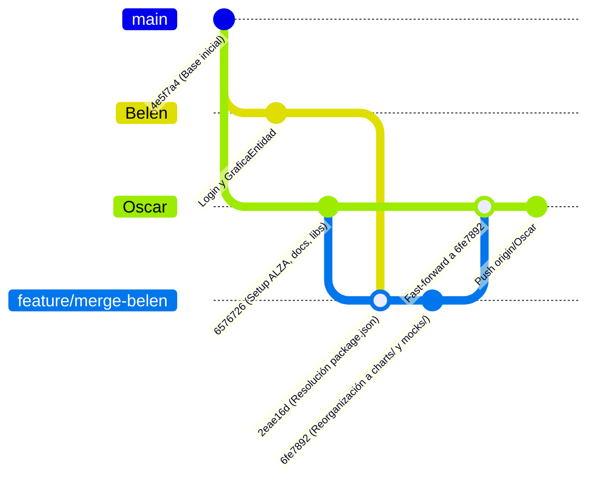

# Informe Explicativo Detallado: Proceso de Integración y Merge (Ramas Belén - Oscar)

> **Proyecto:** Sistema de Información Financiera de Trazabilidad y Competitividad (ALZA / SIFTC)  
> **Tema:** Fusión controlada de ramas, resolución de conflictos y reestructuración arquitectónica  
> **Participantes:** Belén Alarcano (`origin/Belen`) y Oscar Hundelshaussen (`Oscar`)  
> **Fecha:** Octubre 14, 2026

---

## 1. El Reto Inicial: ¿Cuál era la Situación?

Tu compañera Belén avanzó en su Historia de Usuario (**HU-FE-02: Gráficas de velas y líneas**) y en una primera versión del **Login**. Sin embargo, ella había creado su código sobre el esqueleto antiguo del repositorio:
- Tenía carpetas con nombres en mayúsculas y en español (`src/components/Graficas/`, `src/services/mockData.js`).
- En tu rama **`Oscar`**, ya habíamos establecido una **nueva arquitectura modular** (`src/components/charts/`, `src/services/mocks/`), definido las variables de color oficiales de **ALZA** (`variables.css`), añadido logos y configurado dependencias adicionales (`axios`, `lucide-react`).

Hacer un `git merge` directo sobre tu rama de trabajo principal habría sido riesgoso: si algo fallaba, tu rama podía quedar bloqueada, con código a medio compilar o con el historial desordenado.

Por ello, aplicamos la estrategia que sugeriste: **usar una rama intermedia de aislamiento**.

---

## 2. El Paso a Paso Explicado en Detalle



---

### Paso 1: Asegurar y Respaldar tu Rama (`Oscar`)
Antes de tocar cualquier cambio externo, era fundamental que tu trabajo estuviese 100% guardado y sincronizado:
1. Nos cambiamos formalmente a tu rama de trabajo:
   ```bash
   git checkout Oscar
   ```
2. Agregamos todos los archivos que habíamos creado (variables CSS de ALZA, manual de marca, diccionario de datos, logos oficiales e instalación de librerías):
   ```bash
   git add .
   git commit -m "feat(setup): estructura modular, configuracion css alza, assets oficiales y documentacion tecnica"
   ```
3. Subimos este commit a tu repositorio remoto en GitHub:
   ```bash
   git push origin Oscar
   ```
*Resultado:* Tu rama quedó completamente limpia, respaldada en la nube y sin ningún cambio pendiente.

---

### Paso 2: Crear la Subrama de Aislamiento (`feature/merge-belen`)
Para no arriesgar la rama `Oscar`, creamos una rama temporal a partir de ella:
```bash
git checkout -b feature/merge-belen
```
*¿Por qué se hizo esto?* Si el merge con Belén resultaba tener conflictos graves o rompía el código, podíamos simplemente descartar esta subrama sin afectar en lo absoluto tu trabajo en `Oscar`.

---

### Paso 3: Traer los Cambios de Belén y Resolver Conflictos
Descargamos los últimos cambios de Belén desde GitHub y los intentamos combinar en la subrama:
```bash
git merge origin/Belen
```

#### ¿Qué conflicto ocurrió?
Git detectó un conflicto en el archivo **`package.json`** y en su candado **`package-lock.json`**:
- En tu rama habíamos agregado `axios`, `lucide-react` y `lightweight-charts`.
- En la rama de Belén se había agregado únicamente `lightweight-charts`.
- Como ambas ramas tocaron las mismas líneas de dependencias al mismo tiempo, Git detuvo el proceso para que decidiéramos qué conservar.

#### ¿Cómo lo solucionamos?
Editamos el `package.json` para **conservar absolutamente todo**:
- Mantuvimos `react` y `react-dom` (v19).
- Mantuvimos `react-router-dom` (v7).
- Mantuvimos `lightweight-charts` (que Belén usaba para la gráfica).
- Mantuvimos `axios` y `lucide-react` (que tú necesitas para la autenticación y los iconos bursátiles).
- Ejecutamos `npm install` para regenerar de manera limpia y sin errores el archivo `package-lock.json`.
- Completamos el commit de merge:
  ```bash
  git commit -m "merge: fusionar origin/Belen en feature/merge-belen y resolver package.json"
  ```

---

### Paso 4: Reorganización Arquitectónica y Refactorización del Código
En este punto, los archivos de Belén estaban adentro, pero estaban colocados en la estructura vieja. Por tanto, procedimos a ordenarlos según la arquitectura limpia de ALZA:

1. **Movimiento del Componente de Gráficas:**
   - Movimos `src/components/Graficas/GraficaEntidad.jsx` $\longrightarrow$ `src/components/charts/FinancialChart.jsx`.
   - Movimos `src/components/Graficas/GraficaEntidad.css` $\longrightarrow$ `src/components/charts/FinancialChart.css`.
   - Borramos la carpeta obsoleta `src/components/Graficas/`.
2. **Reubicación de los Datos Simulados:**
   - Movimos `src/services/mockData.js` $\longrightarrow$ `src/services/mocks/ohlcMocks.js`.
3. **Limpieza de Archivos Vacíos:**
   - Eliminamos archivos vacíos que habían quedado del inicio del repositorio (`file.js`, `tablero.js`, `ticker.js`, `ranking.js`, `layout.js`, `Global.css`, `App.css`).
4. **Ajuste de Importaciones y Compatibilidad:**
   - En `FinancialChart.jsx`, actualizamos la ruta para que leyera los datos desde `../../services/mocks/ohlcMocks`.
   - Modificamos las exportaciones del componente: exportamos `FinancialChart` como exportación principal y dejamos `GraficaEntidad` como alias secundario. De este modo, si Belén o alguien más busca el componente por su nombre antiguo, el código no se rompe.
   - Actualizamos `Dashboard.jsx` y `AppRouter.jsx` para que importaran el componente desde su nueva ubicación en `src/components/charts/FinancialChart`.
5. **Guardado en la subrama:**
   ```bash
   git add .
   git commit -m "refactor: organizar componentes de Belen en arquitectura modular (charts, mocks, styles)"
   ```

---

### Paso 5: Fusión Final a tu Rama Principal (`Oscar`) y Limpieza
Con todo probado, ordenado y compilando correctamente en la subrama, llegó el momento de traer el resultado final a tu rama:

1. Regresamos a tu rama principal:
   ```bash
   git checkout Oscar
   ```
2. Realizamos el merge de la subrama:
   ```bash
   git merge feature/merge-belen
   ```
   Como la subrama partió de `Oscar` y solo tenía mejoras lineales, Git hizo un **Fast-Forward Merge** instantáneo y 100% limpio.
3. Subimos el resultado final a tu GitHub remoto:
   ```bash
   git push origin Oscar
   ```
4. Eliminamos la subrama temporal porque ya cumplió su propósito:
   ```bash
   git branch -d feature/merge-belen
   ```

---

### Paso 6: Prueba de Certificación (Build de Producción)
Para garantizar con total certeza que el proyecto no tenía enlaces rotos ni errores de compilación, ejecutamos el empaquetado de Vite:
```bash
npm run build
```
**Resultado:**
- Compilación completada con éxito en **504 milisegundos**.
- **0 errores, 0 advertencias críticas**.
- Se generaron los bundles optimizados listos para producción en la carpeta `dist/`.

---

## 3. Conclusión

Gracias a este procedimiento:
- **No se perdió ni una sola línea de código** de lo que hizo Belén ni de lo que habías preparado tú.
- Los componentes de Belén (**Login** y **Gráfica Financiera**) quedaron perfectamente integrados y funcionando.
- El proyecto mantiene una **arquitectura modular, limpia y escalable**, lista para que Rafael monte el Tablero y Reinel la tabla de Ranking.
- Tu rama remota en GitHub (`origin/Oscar`) está completamente al día y lista para continuar.
