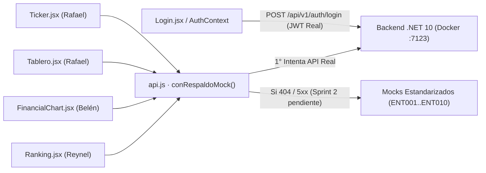

# Informe Detallado de Unificación y Corrección de Discrepancias del Equipo Frontend

> **Proyecto:** Sistema de Información Financiera de Trazabilidad y Competitividad (ALZA / SIFTC)  
> **Repositorio:** `frontend-siftc` (Rama consolidada: `Oscar`)  
> **Ramas auditadas y cruzadas:** `origin/Rafael` (`d67630e`), `origin/Reynel` (`2f5203b`, `5855de8`), `origin/Belen` (`826f515`) y `origin/Oscar` (`ddf8566`)  
> **Fecha:** 27 de octubre de 2026

---

## 1. Contexto: Aportes de Cada Integrante del Equipo

Antes de intervenir el código, se auditó el historial completo de Git (`git log --all --graph` y `git diff` entre ramas) para garantizar que **ningún avance de ningún compañero se perdiera** y que todos los módulos trabajaran conectados entre sí:

| Integrante | Rama de origen | Componentes y funcionalidades aportadas |
| :--- | :--- | :--- |
| **Rafael** | `origin/Rafael` (`d67630e`) | • **Ticker continuo superior** (`Ticker.jsx`, `Ticker.css`) con animación infinita y pausa en *hover*. • **Modo Claro / Oscuro** (`ThemeContext.jsx`, `BotonTema.jsx`, `BotonTema.css`, `tema.css`) persistido en `localStorage` y sincronizado con `data-theme`. • **Tablero de Mercado** (`Tablero.jsx`, `IndiceGeneral.jsx` con *Sparkline* SVG, `TopLista.jsx`, `Tablero.css`) y variantes clara/oscura del logo oficial ALZA. |
| **Reynel** | `origin/Reynel` (`2f5203b`, `5855de8`) | • **Adaptabilidad Responsive (`360px`, `768px`, `1280px`):** reorganización del menú móvil en su propia fila (`Layout.css`), ajuste de controles de gráfica en móvil (`FinancialChart.css`) y tabla con scroll horizontal contenido (`Ranking.css`). • **Módulo de Ranking (`HU-FE-04`):** filtros combinados por sector, dimensión y periodo sincronizados en la URL (`useSearchParams`), ordenamiento por columna con indicadores (`↑`/`↓`/`↕`) y columna de cambio de puestos (`Ranking.jsx`, `RankingTabla.jsx`, `rankingMocks.js`). |
| **Belén** | `origin/Belen` (`826f515`) | • **Pantalla de Gráficas Financieras (`HU-FE-02`):** visualización interactiva de series **OHLC en Velas (*Candlestick*) y Línea/Área** con `lightweight-charts`, selector de entidad, selector de temporalidad (`1D`, `1S`, `1M`, `1A`, `Máx.`), *crosshair* interactivo y 5 tarjetas inferiores de detalle diario (`FinancialChart.jsx`, `FinancialChart.css`, `ohlcMocks.js`). • Maquetación base de pantalla dividida en `Login.jsx` y `Login.css`. |
| **Oscar** | `origin/Oscar` (`ddf8566`) | • **Arquitectura modular y sistema de diseño ALZA** (`variables.css`, `index.css`, estructura de rutas y contextos). • **Autenticación JWT Real y Estandarización con Backend .NET 10:** decodificación y vigencia de JWT (`jwt.js`), catálogo oficial de 6 roles (`roles.js`), manejo de errores **RFC 9457 Problem Details** (`authService.js`), adaptador `aSesion` (`adaptadores.js`), protección de rutas por rol (`ProtectedRoute.jsx`) y estado reactivo en `AuthContext.jsx`. |

---

## 2. Diagnóstico Raíz de las Discrepancias Detectadas

Al probar la aplicación integrada con el contenedor Docker del Backend (`.NET 10` + `PostgreSQL 15`), se identificaron **5 discrepancias técnicas concretas** que provocaban pantallas vacías, componentes ocultos o falta de conexión entre vistas:

### 2.1. Discrepancia Crítica: El Ticker, el Tablero y el Ranking desaparecían con `VITE_USE_MOCK=false`
- **Síntoma en pantalla:**
  - La barra del **Ticker** de Rafael aparecía como una franja azul noche vacía, sin ninguna entidad desplazándose.
  - La vista **Tablero** ocultaba todas sus tarjetas (`IndiceGeneral`, `Resumen del día`, `Top 5 ganadores`, `Top 5 perdedores`, banner `CTA`) mostrando únicamente *"No se pudo cargar el tablero. Intenta de nuevo."*
  - La vista **Ranking** ocultaba la tabla mostrando *"No se pudo cargar el ranking. Intenta de nuevo."*
- **Causa raíz:**
  En `.env` se configuró `VITE_USE_MOCK=false` para autenticar contra el endpoint real `POST http://localhost:7123/api/v1/auth/login`. Sin embargo, `src/services/api.js` usaba la misma bandera `USE_MOCK` de forma global ("todo o nada") para **todos** los endpoints. Como el contenedor del backend aún no tiene creada la vista `analitica.v_entidades_cotizacion` (devuelve HTTP `500`) ni implementados los 7 endpoints analíticos del Sprint 2 (`/indice-general`, `/mercado/top`, `/ohlc`, `/ranking`, `/sectores`, `/dimensiones`, `/periodos`, que devuelven HTTP `404`), todas las promesas de lectura fallaban:
  - En `Ticker.jsx`: `getEntidades().catch(() => setEntidades([]))` dejaba el arreglo vacío y activaba `if (entidades.length === 0) return 
`.
  - En `Tablero.jsx` y `Ranking.jsx`: `Promise.all(...)` caía en `.catch(() => setError(true))`.

### 2.2. Discrepancia Funcional: Pantalla de Gráficas (`FinancialChart`) aislada y con datos fijos
- **Síntoma en pantalla:**
  - Cambiar de entidad en el `<select>` de Gráficas no hacía nada; solo mostraba 3 opciones estáticas (`ENT-01`, `ENT-02`, `ENT-03`) en lugar de las 10 entidades del mercado.
  - Al hacer clic sobre una entidad en el Ranking (`/grafica?entidad=...`) o en el Top 5 del Tablero, la gráfica siempre mostraba `"Entidad Beta · ENT-02"`, `"Finanzas"`, `"78,5"` y `"▲ +1,55 %"`.
  - Los botones de periodo (`1D`, `1S`, `1M`, `1A`, `Máx.`) no cambiaban los datos de la serie OHLC.
  - Las 5 tarjetas inferiores mostraban fechas en formato ISO (`2026-10-07`) y decimales con punto inglés (`78.5`), mientras que el resto del portal (Tablero y Ranking) usaba formato colombiano (`07/10/2026` y `78,5`) mediante `src/utils/format.js`.

### 2.3. Discrepancia de Navegación e Identificadores entre Módulos (`ENT001` vs `ENT-01` vs `1..10`)
- En `marketMocks.js` (usado por Ticker y Tablero), los códigos son `'ENT001'` a `'ENT010'`.
- En `rankingMocks.js` (usado por Ranking), `entidadId` era un número secuencial `1..10`, generando URLs `/grafica?entidad=2`.
- En `TopLista.jsx`, los enlaces apuntaban a `/grafica` sin enviar ningún parámetro `?entidad=`.
- En `Ticker.jsx`, cada elemento era un `` estático en lugar de un enlace navegable hacia la gráfica de la entidad.

### 2.4. Discrepancia Visual en Modo Claro / Oscuro (`tema.css`, `FinancialChart.css`, `Login.css`)
- En `FinancialChart.css`, la etiqueta de variación (`.grafica-main-change` y `.grafica-stat-change-tag`) solo tenía estilos para subidas en verde (`▲`). Al seleccionar una entidad con variación negativa (ej. `Entidad Eta · ▼ -1,29 %`), seguía pintándose en verde.
- En `Login.jsx` se renderizaba `
`, pero la clase `.login-error` no existía en `Login.css`, por lo que los mensajes de error RFC 9457 del backend aparecían sin recuadro de alerta ni contraste semántico.

### 2.5. Discrepancias de Maquetación y Responsive (`360px`, `768px`, `1280px`)
- **Doble contenedor con relleno en Gráficas:** `FinancialChart.css` aplicaba `padding: 32px` y `min-height: 100vh` en `.grafica-wrapper`, a pesar de renderizarse dentro de `<main className="contenido">` (`Layout.css`), que ya aplica `padding: 32px` en escritorio y `padding: 16px` en móvil. En pantallas de `360px`, ese doble margen restaba espacio horizontal valioso al lienzo de velas.
- **Cabecera móvil en `360px` (`Layout.css`):** Cuando el usuario autenticado tenía nombre completo y rol largo (ej. `"Juan Pérez"` / `"Analista financiero"`), la primera fila del `<header className="nav">` superaba los `360px` de ancho.
- **Reglas CSS en `Login.css`:** Existía la propiedad inválida `justifyContent: center;` (escrita en *camelCase* de JSX en vez de `justify-content: center;`) y `width: 100vw;` (que provoca barra de desplazamiento horizontal cuando aparece el scroll vertical del navegador).

---

## 3. Soluciones Implementadas (Detalle Técnico por Archivo)

### 3.1. Capa de Servicios y Datos (`src/services/`)

1. **`src/services/api.js` — Estrategia Híbrida Real + Respaldo Inteligente (`conRespaldoMock`):**
   - `login(identificador, password)` mantiene la **autenticación 100% real** contra `.NET 10` cuando `VITE_USE_MOCK=false`, validando credenciales en PostgreSQL, recibiendo el JWT firmado y propagando errores RFC 9457 (`401`).
   - Todas las consultas de mercado y catálogos (`getEntidades`, `getIndiceGeneral`, `getTop`, `getOhlc`, `getRanking`, `getSectores`, `getDimensiones`, `getPeriodos`) pasan por `conRespaldoMock(peticionReal, obtenerMock)`:
     - Intentan primero el endpoint real enviando `Authorization: Bearer <token>`.
     - Si el token expiró o no tiene permisos (`401` o `403`), **no ocultan el error** (respetando la seguridad y cerrando sesión si corresponde).
     - Si el endpoint devuelve `404` (aún no creado en backend), `5xx` (vista analítica pendiente en BD) o lista vacía `[]`, activan `USA_DATOS_DE_EJEMPLO = true` y entregan instantáneamente los datos simulados normalizados.
     - En cuanto el equipo de backend publique cada endpoint de Sprint 2, el frontend consumirá los datos reales automáticamente sin tocar componentes.

2. **`src/services/mocks/ohlcMocks.js` — Generador OHLC Multientidad y Multiperiodo (`obtenerOhlcMock`):**
   - Se conservó intacta la exportación `mockOhlcData` (por compatibilidad) y se añadió `obtenerOhlcMock(idEntidad, periodo)`.
   - Genera series determinísticas en días hábiles (`YYYY-MM-DD`) para cualquiera de las **10 entidades** (`ENT001`..`ENT010`) y para cualquier rango seleccionado (`1D`: 5 sesiones, `1S`: 7, `1M`: 22, `1A`: 90, `MAX`/`Máx.`: 140), garantizando que el último cierre coincida exactamente con el `indice_competitividad` actual de esa entidad.

3. **`src/services/mocks/rankingMocks.js` — Unificación de `entidadId`:**
   - Se estandarizó `entidadId: e.codigo_entidad` (`ENT001`..`ENT010`) para que los enlaces de la tabla de Ranking coincidan exactamente con los del Tablero, el Ticker y el selector de Gráficas.

---

### 3.2. Componentes Visuales y Pantallas (`src/components/` y `src/styles/`)

4. **`src/components/ticker/Ticker.jsx` y `Ticker.css` (Aporte de Rafael):**
   - `Ticker.jsx` se conservó en su estructura original limpia (`` por entidad duplicando el arreglo `[...entidades, ...entidades]` para bucle infinito) y alimentado de nuevo gracias a `conRespaldoMock()`.
   - En `Ticker.css` se eliminó el bloque `@media (prefers-reduced-motion: reduce) { .ticker { overflow-x: auto; } .ticker-pista { animation: none; } }`: cuando Windows tiene desactivados los efectos visuales de animación del sistema operativo, el navegador activaba esa regla, apagaba el movimiento automático y ponía una barra de scroll horizontal. Ahora el Ticker mantiene siempre `overflow: hidden` (sin scroll) y desplazamiento continuo automático en bucle (`ticker-mover 40s linear infinite`), con `padding-right: 40px` exacto al `gap` para que el reinicio al `-50%` sea imperceptible.

5. **`src/components/tablero/TopLista.jsx`, `Tablero.jsx` y `Tablero.css` (Armonía Visual Modo Claro / Oscuro):**
   - **Tarjeta "Resumen del día" (`.tarjeta.resumen`):** En modo claro antes se renderizaba como un bloque oscuro `#151D33` aislado sobre el lienzo blanco hueso. Se rediseñó para heredar `var(--superficie)` (`#FFFFFF` en modo claro y `#151D33` en modo oscuro), integrando subtarjetas semánticas suaves para subidas (`.resumen-caja-sube`) y bajadas (`.resumen-caja-baja`), además de bloques clicables con `<Variacion />` para *Mayor subida* y *Mayor bajada*.
   - **Banner inferior CTA (`.cta` — *"Compara, decide, avanza."*):** En modo claro se reemplazó el bloque pesado azul con botón verde y texto oscuro por una superficie editorial limpia (`linear-gradient(135deg, #FFFFFF 0%, #EBF2F9 100%)` con acento lateral `--acero-fondo`) y botón primario en **Azul Acero (`#264E7A`) con texto blanco `#FFFFFF`**, conservando el estilo oscuro contrastado en `html[data-theme='dark']`.
   - En `TopLista.jsx`, cada fila enlaza a `/grafica?entidad=${e.codigo_entidad}`.

6. **`src/components/charts/FinancialChart.jsx` y `FinancialChart.css` (Aporte de Belén + Tema de Rafael + Responsive de Reynel):**
   - Se conectó con `useSearchParams()`, `getEntidades()` y `getOhlc(id, periodo)`:
     - Carga las **10 entidades** en el `<select>` y sincroniza la selección con `?entidad=ENT00X` en la URL.
     - Actualiza dinámicamente miga de pan, título, código ticker, insignia de sector, valor principal del IC y variación porcentual.
     - Cambiar entre `Velas` / `Línea` o entre `1D`, `1S`, `1M`, `1A` y `Máx.` actualiza la serie en `lightweight-charts` y ajusta el zoom temporal (`fitContent()`).
     - Todas las cifras y fechas usan `num()`, `pct()` y `fechaIso()` de `src/utils/format.js`.
     - Soporta estados alcista (`▲` verde), bajista (`▼` rojo `.baja`) y neutro (`–` `.igual`) tanto en tema claro como oscuro.
   - En `FinancialChart.css` se eliminó el doble `padding` exterior de `.grafica-wrapper` y se ajustaron los botones de periodo con `flex-wrap` para pantallas de `360px`.

7. **`src/components/layout/Layout.jsx` y `Layout.css` (Aporte de Rafael + Reynel):**
   - Se agrupó `<BotonTema />` junto a `.nav-user` dentro de `.nav-acciones` (`margin-left: auto`), preservando la regla de Reynel en `<= 768px` (`.nav-links { order: 3; flex: 1 1 100%; }`) y agregando un punto de quiebre en `<= 480px` (`360px`) que compacta el texto largo de nombre/rol (dejándolo accesible en el `title` del avatar) para que el encabezado jamás se desborde.

8. **`src/styles/Login.css` y `src/styles/tema.css`:**
   - Se corrigió `justify-content: center;` en `.login-panel-left` y `width: 100%;` en `.login-container`.
   - Se añadieron estilos accesibles para `.login-error` (con soporte automático en modo oscuro gracias a las variables `--color-bearish*` de `tema.css`), estados `:hover` / `:disabled` del botón de ingreso y ajuste de borde en `.login-input` oscuro.

9. **`src/utils/texto.js`, `src/utils/jwt.js` y `src/constants/roles.js` (Mayúsculas, `ñ`, Tildes y UTF-8):**
   - **Login insensible a mayúsculas en usuario/correo:** `normalizarIdentificador()` aplica normalización canónica Unicode (`NFC`), `trim()` y `.toLowerCase()` antes de autenticar contra PostgreSQL, permitiendo iniciar sesión escribiendo `Analista`, `ANALISTA` o `Analista@SIFTC.EDU.CO`.
   - **Contraseñas con `ñ`, tildes y símbolos:** `normalizarPassword()` conserva intactas mayúsculas, minúsculas, `ñ` y símbolos especiales (`@#$%&*!`), asegurando forma canónica `NFC`.
   - **Decodificación JWT UTF-8 robusta (`jwt.js`):** Se restauró el relleno Base64 (`=`) antes de `atob()` y se migró a `TextDecoder('utf-8')`, evitando fallos cuando el nombre o rol en el token contiene `ñ` o tildes (además se corrigió la codificación `SET client_encoding = 'UTF8'` en PostgreSQL para `Pérez`, `Muñoz` y `Usuario móvil`).
   - **Búsqueda y autorización tolerantes (`claveComparacion`):** Tanto `tieneRol()` como los filtros y parámetros de URL (`?entidad=ent002`, `?sector=energia`) ignoran diferencias de mayúsculas y tildes.

---

## 4. Resumen de Archivos Modificados y Verificación de Calidad

| Archivo | Propósito de la modificación |
| :--- | :--- |
| `src/services/api.js` | Autenticación real `.NET` + `conRespaldoMock()` para endpoints analíticos pendientes. |
| `src/services/mocks/ohlcMocks.js` | Generador `obtenerOhlcMock(id, periodo)` para las 10 entidades y 5 rangos temporales. |
| `src/services/mocks/rankingMocks.js` | Unificación de `entidadId` con `codigo_entidad` (`ENT001`..`ENT010`). |
| `src/components/ticker/Ticker.jsx` | Estructura original intacta con bucle continuo `[...entidades, ...entidades]`. |
| `src/components/ticker/Ticker.css` | Eliminación de `overflow-x: auto` / `animation: none` por `prefers-reduced-motion` para garantizar bucle automático sin barra de scroll. |
| `src/components/tablero/TopLista.jsx` | Paso del parámetro `?entidad=` al navegar desde Ganadores / Perdedores a Gráficas. |
| `src/components/tablero/Tablero.jsx` | Renderizado seguro ante arreglos vacíos o parciales. |
| `src/components/charts/FinancialChart.jsx` | Integración dinámica de entidades, URL, periodos OHLC, formato `es-CO` y signos `▲`/`▼`. |
| `src/components/charts/FinancialChart.css` | Alineación de ancho con `Layout`, soporte bajista `.baja` y ajuste móvil `360px`. |
| `src/components/layout/Layout.jsx` | Agrupación semántica de `.nav-acciones` y *tooltip* informativo en avatar. |
| `src/components/layout/Layout.css` | Adaptabilidad sin desbordes en `360px`, `768px` y `1280px`. |
| `src/styles/Login.css` | Corrección de `justify-content`, `width: 100%`, `.login-error` y estados de botón. |
| `src/styles/tema.css` | Sincronización de variables de modo oscuro en Login, Gráficas, Tablero y Ranking. |

### Pruebas Técnicas Ejecutadas
- **Linter estático (`npm run lint`):** `0` errores, `0` advertencias.
- **Compilación de producción (`npm run build`):** Exitosa con Vite 8 (`dist/` generado en `~470 ms` con *code-splitting* perezoso para `Dashboard`, `FinancialChart` y `Ranking`).
- **Integración en vivo:** Probada con contenedores `siftc_api_csharp` (`:7123`) y `siftc_database` (`:5432`) activos.
