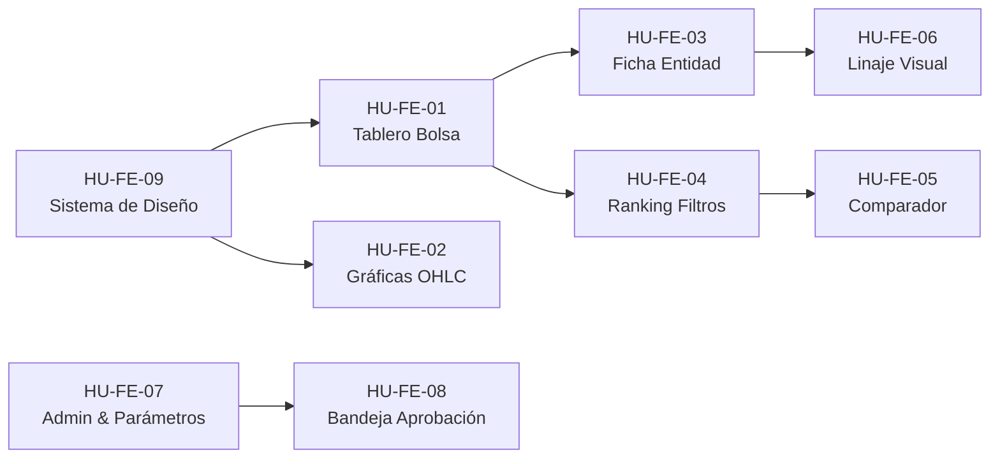

# Historias de Usuario — Frontend (SIFTC / ALZA)

> **Documento Oficial de Referencia Técnica y Criterios de Aceptación**  
> **Fuente:** *Historias de Usuario – SIFTC (Sep 25, 2026 · @Isa)*  
> **Área:** Frontend (Web Portal)  
> **Total Historias de Frontend:** 9 Historias de Usuario (HU-FE-01 a HU-FE-09) · **57 Puntos de Historia**  
> **Historias Vinculadas de Otros Equipos:** HU-DD-08 (Diccionario en el portal), HU-BE-01/02 (Login/RBAC)

---

## 1. Resumen y Estado Consolidado del Backlog Frontend

| ID | Historia de Usuario | Responsable Original | Puntos | Sprint | Estado en Código (`main2` / `Oscar`) | Implementación en Frontend |
| :--- | :--- | :--- | :---: | :---: | :---: | :--- |
| **HU-FE-01** | Ver tablero principal tipo bolsa | Rafael Barriga | 8 | 2 | **Terminada / Validada** | `src/pages/Dashboard.jsx`, `src/components/ticker/Ticker.jsx`, `src/components/dashboard/TopEntidades.jsx` |
| **HU-FE-02** | Ver gráficas de velas y líneas | Sara Alarcano | 8 | 2 | **Terminada / Validada** | `src/components/charts/FinancialChart.jsx`, `Lightweight Charts` |
| **HU-FE-03** | Consultar ficha de entidad | Oscar Hundelshaussen | 5 | 3 | **Terminada / Validada** | `src/components/charts/FinancialChart.jsx` (Terminal Split), `MetricaDetalleModal.jsx` |
| **HU-FE-04** | Filtrar ranking | Reinel Alfaro | 5 | 2 | **Terminada / Validada** | `src/components/ranking/Ranking.jsx`, `RankingTabla.jsx` |
| **HU-FE-05** | Comparar entidades | Rafael Barriga | 5 | 5 | **Terminada / Validada** | `src/components/comparador/Comparador.jsx`, `TablaComparativa.jsx` |
| **HU-FE-06** | Navegar el linaje de un valor | Rafael Barriga | 8 | 6 | **Pendiente Backend** | Requiere publicación de `HU-BE-10` (`GET /api/v1/linaje/{id}`) |
| **HU-FE-07** | Administrar usuarios, roles y parámetros | Reinel Alfaro | 8 | 4 | **Terminada / Validada** | `src/pages/Administracion.jsx`, `UsuariosAdmin.jsx`, `PesosAdmin.jsx` |
| **HU-FE-08** | Aprobar publicaciones (Bandeja) | Sara Alarcano | 5 | 5 | **Terminada / Validada** | `src/pages/BandejaAprobaciones.jsx`, `BandejaAprobaciones.css`, `api.js` |
| **HU-FE-09** | Sistema de diseño institucional y responsive | Rafael Barriga | 5 | 1 | **Terminada / Validada** | `.agent/skills/clean-financial-design/SKILL.md`, `src/index.css`, variables CSS |

---

## 2. Detalle de Historias de Usuario del Frontend (HU-FE)

---

### HU-FE-01 – Ver tablero principal tipo bolsa
- **Responsable:** Rafael Barriga
- **Puntos:** 8 pts · **Sprint:** 2
- **Historia:**
  > **Como** gerente,  
  > **quiero** un tablero con ticker, índice general y top ganadores y perdedores,  
  > **para** entender el mercado de un vistazo.

#### Criterios de Aceptación (Dado / Cuando / Entonces):
1. **CA 1:** Dado un usuario autenticado, cuando abre el portal, entonces ve ticker, índice general, top 5 ganadores y top 5 perdedores del día.
2. **CA 2:** Dada una conexión estándar, cuando carga el tablero, entonces la carga inicial tarda menos de 3 s.
3. **CA 3:** Dada una variación positiva o negativa, cuando se muestra, entonces se distingue con color y símbolo (▲ / ▼), no solo con color.

---

### HU-FE-02 – Ver gráficas de velas y líneas
- **Responsable:** Sara Alarcano
- **Puntos:** 8 pts · **Sprint:** 2
- **Historia:**
  > **Como** analista financiero,  
  > **quiero** gráficas de velas y líneas del IC,  
  > **para** analizar tendencias.

#### Criterios de Aceptación (Dado / Cuando / Entonces):
1. **CA 1:** Dada una entidad, cuando abro su gráfica, entonces puedo alternar entre velas y línea.
2. **CA 2:** Dados los filtros 1D, 1S, 1M, 1A y Máx., cuando selecciono uno, entonces la gráfica se actualiza con ese rango.
3. **CA 3:** Dada la gráfica, cuando paso el cursor sobre un punto, entonces el tooltip muestra fecha, apertura, máximo, mínimo y cierre; y puedo hacer zoom.

---

### HU-FE-03 – Consultar ficha de entidad
- **Responsable:** Oscar Hundelshaussen
- **Puntos:** 5 pts · **Sprint:** 3
- **Historia:**
  > **Como** gerente,  
  > **quiero** una ficha por entidad,  
  > **para** ver en un solo lugar su desempeño y posición.

#### Criterios de Aceptación (Dado / Cuando / Entonces):
1. **CA 1:** Dada una entidad, cuando abro su ficha, entonces veo IC actual, variación, posición en ranking, métricas por dimensión y gráfica histórica.
2. **CA 2:** Dados los datos de la ficha, cuando se comparan con la API, entonces coinciden en el 100 % de los campos.
3. **CA 3:** Dada una métrica en la ficha, cuando hago clic en ella, entonces veo su definición y su linaje (integrado con el modal interactivo y enlace al Diccionario Oficial).

---

### HU-FE-04 – Filtrar ranking
- **Responsable:** Reinel Alfaro
- **Puntos:** 5 pts · **Sprint:** 2
- **Historia:**
  > **Como** gerente,  
  > **quiero** filtrar el ranking por sector, dimensión y periodo,  
  > **para** comparar entidades de mi industria.

#### Criterios de Aceptación (Dado / Cuando / Entonces):
1. **CA 1:** Dado el ranking, cuando selecciono un sector y un periodo, entonces veo solo esas entidades ordenadas por IC descendente.
2. **CA 2:** Dada cualquier columna, cuando hago clic en su encabezado, entonces el ranking se ordena por ella.
3. **CA 3:** Dado un ranking filtrado, cuando abro una entidad, entonces su ficha conserva el periodo seleccionado.
4. *Regla de Seguridad Obligatoria (HU-FE-07 / Decisión D1):* Para el rol `Gerente / Directivo`, las columnas de posición y cambio de posición se ocultan (`null`). El `Usuario móvil` no tiene acceso a esta ruta (HTTP 403).

---

### HU-FE-05 – Comparar entidades
- **Responsable:** Rafael Barriga
- **Puntos:** 5 pts · **Sprint:** 5
- **Historia:**
  > **Como** analista financiero,  
  > **quiero** comparar hasta 4 entidades lado a lado,  
  > **para** evaluar su competitividad relativa.

#### Criterios de Aceptación (Dado / Cuando / Entonces):
1. **CA 1:** Dado el comparador, cuando agrego entidades, entonces admite de 2 a 4 y bloquea una quinta con aviso.
2. **CA 2:** Dadas las entidades seleccionadas, cuando se muestran, entonces veo sus métricas en columnas y sus IC en una misma gráfica.
3. **CA 3:** Dada una comparación, cuando la exporto, entonces se genera el archivo con los mismos datos.

---

### HU-FE-06 – Navegar el linaje de un valor
- **Responsable:** Rafael Barriga
- **Puntos:** 8 pts · **Sprint:** 6
- **Historia:**
  > **Como** auditor,  
  > **quiero** hacer clic en cualquier valor y ver su linaje,  
  > **para** rastrear su origen sin consultas técnicas.

#### Criterios de Aceptación (Dado / Cuando / Entonces):
1. **CA 1:** Dado un valor en tablero, ficha o ranking, cuando selecciono "Ver origen", entonces se abre el visor de linaje.
2. **CA 2:** Dado el visor, cuando se muestra, entonces presenta la cadena como diagrama de nodos navegables.
3. **CA 3:** Dado un nodo, cuando hago clic, entonces veo su detalle: fuente, lote, regla o versión de fórmula y fecha.
4. *Dependencia Técnica:* Sujeto a que Backend implemente y exponga `HU-BE-10 – Consultar linaje por API`.

---

### HU-FE-07 – Administrar usuarios, roles y parámetros
- **Responsable:** Reinel Alfaro
- **Puntos:** 8 pts · **Sprint:** 4
- **Historia:**
  > **Como** administrador,  
  > **quiero** un módulo de administración,  
  > **para** gestionar accesos y parámetros sin soporte técnico.

#### Criterios de Aceptación (Dado / Cuando / Entonces):
1. **CA 1:** Dado un usuario con rol Administrador, cuando entra al módulo, entonces puede crear, editar y desactivar usuarios y asignar roles.
2. **CA 2:** Dado un usuario sin rol Administrador, cuando intenta acceder a la ruta del módulo, entonces se le niega el acceso.
3. **CA 3:** Dado el formulario de pesos del IC, cuando los valores no suman 100 %, entonces se muestra el error y no se permite guardar.
4. *Matriz RBAC / Decisión D3:* `Administrador` y `Analista financiero` pueden editar y guardar versiones de pesos (`POST /api/v1/ic/configuracion/versiones`). El rol `Auditor` tiene acceso de **Solo Lectura** (`L`).

---

### HU-FE-08 – Aprobar publicaciones (Bandeja de Aprobaciones)
- **Responsable:** Sara Alarcano
- **Puntos:** 5 pts · **Sprint:** 5 (adelantada en Sprint 4)
- **Historia:**
  > **Como** analista financiero,  
  > **quiero** una bandeja con los cálculos pendientes,  
  > **para** aprobarlos o rechazarlos rápido.

#### Criterios de Aceptación (Dado / Cuando / Entonces):
1. **CA 1:** Dada la bandeja, cuando la abro, entonces veo los cálculos pendientes con entidad, métrica, valor, variación y fecha (lote, archivo, fecha, registros válidos y totales, estado).
2. **CA 2:** Dado un cálculo, cuando lo apruebo o rechazo, entonces desaparece de la bandeja y el estado se actualiza.
3. **CA 3:** Dado un rechazo, cuando lo confirmo, entonces el comentario es obligatorio (máximo 500 caracteres).
4. *Segregación de Funciones:* Un analista no puede aprobar un lote que él mismo ejecutó manualmente (`idUsuarioEjecutor !== usuario.id`). Solo `Analista financiero` decide; `Admin`, `Data Steward` y `Auditor` tienen solo consulta.

---

### HU-FE-09 – Aplicar colores institucionales y diseño responsive
- **Responsable:** Rafael Barriga
- **Puntos:** 5 pts · **Sprint:** 1
- **Historia:**
  > **Como** usuario,  
  > **quiero** un portal con los colores institucionales de la Universidad que funcione en cualquier pantalla,  
  > **para** identificarlo como un producto de la institución y usarlo cómodamente.

#### Criterios de Aceptación (Dado / Cuando / Entonces):
1. **CA 1:** Dado el manual de imagen de la Universidad, cuando se define el sistema de diseño, entonces la paleta, la tipografía y el logo se toman de ese manual.
2. **CA 2:** Dada cualquier pantalla del portal, cuando se revisa, entonces usa solo la paleta institucional y mantiene contraste legible.
3. **CA 3:** Dado un ancho de pantalla desde 360 px, cuando navego el portal, entonces no hay desplazamiento horizontal ni contenido cortado (garantizado con side-drawer en móvil y terminal-split en desktop).

---

## 3. Historias Transversales Integradas en Frontend

### HU-DD-08 – Consultar diccionario desde el portal
- **Equipo:** Diccionario de datos · **Responsable:** Frell Beleño
- **Puntos:** 5 pts · **Sprint:** 5
- **Historia:**
  > **Como** usuario del portal,  
  > **quiero** buscar términos y métricas en el diccionario,  
  > **para** entender lo que veo en los tableros.

#### Criterios de Aceptación (Dado / Cuando / Entonces):
1. **CA 1:** Dado el portal web, cuando busco por nombre, código o sinónimo, entonces obtengo resultados en menos de 2 s.
2. **CA 2:** Dada una métrica en un tablero, cuando hago clic en su nombre, entonces se abre su ficha del diccionario.
3. **CA 3:** Dado un dato restringido, cuando lo busca un usuario sin permiso, entonces no aparece en los resultados (filtro estricto por rol: Público, Interno, Confidencial, Restringido).
